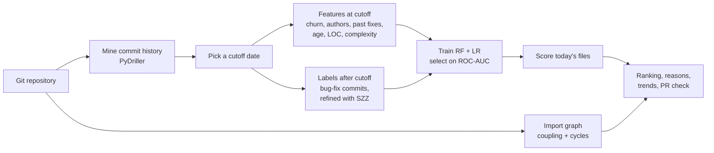

# EvoMind

**Know which files will break next, before they do.**

EvoMind reads a Git repository's commit history, learns which files went on to need bug fixes, and ranks today's files by the chance that they will need one next. Each score comes with the reasons behind it, a trend over time, and a map of the import loops that tie the codebase together.


https://github.com/user-attachments/assets/cd87e0ca-d93b-4c7e-a738-8857d207b30d


**Live demo:** [evomindai.vercel.app](https://evomindai.vercel.app) · mirror on [Hugging Face](https://huggingface.co/spaces/Deshmukh09/evomind) · [launch video](brag-output/brag.mp4)

> The online demo replays saved analyses of `pallets/click`, `pallets/flask`, `psf/requests` and `django/django` with the full dashboard. To scan any repository, run EvoMind locally (below).

---

## Why

Code review time is limited, and most teams decide where to look by gut feeling. Yet a repository's own history already records which kinds of files keep needing fixes: the ones that change often, are touched by many people, have grown complex, and have been fixed before. EvoMind turns that history into an evidence-based priority list, so reviewers and maintainers spend their attention where defects are most likely.

## What you get

| | |
|---|---|
| **Risk ranking** | Every current file scored 0–1 by its chance of needing a bug fix within the next 365 days |
| **Reasons per file** | Up to three plain-language reasons, e.g. `churn 6,405 · top 2% · +0.14` (if this file's churn were typical, its risk would fall by 0.14) |
| **Risk trend** | The same model re-scores six points in the repository's history, so you can see which files are getting riskier |
| **Architecture map** | Coupling, instability and circular-import groups for Python, JS/TS and Java (Tarjan's algorithm) |
| **Honest evaluation** | Random Forest vs. Logistic Regression on held-out files, chosen by measured ROC-AUC, plus an optional time-based (rolling-origin) evaluation |
| **Pull-request check** | Scores the files a PR touches and can post one updating comment through a signed GitHub webhook |
| **AI suggestions** (opt-in) | Refactoring advice for one risky file, generated by an LLM via Groq |

## How it works



1. **Mine.** The repository is cloned once and its full commit history is read with PyDriller.
2. **Split in time.** A cutoff date is chosen partway through history. Features only see commits at or before it; labels only look after it, so the model can never peek at the fix it is meant to predict.
3. **Measure.** For each file: process metrics (churn, commit and author counts, prior bug fixes, age, recency) and static metrics (lines of code, cyclomatic complexity, function count; maintainability and Halstead metrics for Python). Static metrics cover every language [lizard](https://github.com/terryyin/lizard) supports.
4. **Label.** A file is bug-prone if a bug-fixing commit touches it within the horizon. **SZZ** then traces each fix back with `git blame` and keeps the label only if the defect was introduced before the cutoff. An optional LLM check (following [LLM4SZZ](https://arxiv.org/abs/2504.01404)) filters out blame false positives such as formatting passes.
5. **Train and select.** A Random Forest and a Logistic Regression baseline are trained on the same 70% of files and scored on the same held-out 30%. The one with the higher ROC-AUC scores the files, because the product is a ranking.
6. **Explain.** Each feature is reset to the repository median and the drop in risk is measured, giving reasons that are exactly what the model does.

The full method, design decisions and their reasoning are in **[backend/README.md](backend/README.md)**.

## Results on real repositories

365-day horizon, held-out 30% of files (ROC-AUC: 0.5 = random, 1.0 = perfect).

| Repository | Files | Bug-prone share | Selected model | ROC-AUC | F1 |
|---|---:|---:|---|---:|---:|
| django/django | 2,719 | 12.1% | Random Forest | 0.911 | 0.588 |
| pallets/flask | 74 | 13.5% | Logistic Regression | 0.900 | 0.571 |
| psf/requests | 35 | 25.7% | Logistic Regression | 0.833 | 0.571 |
| pallets/click | 63 | 14.3% | Random Forest | 0.812 | 0.400 |

**Over time (rolling-origin):** training on one period and testing on the next, unseen one, ROC-AUC stays at 0.668 ± 0.006 on Flask and 0.795–0.882 on Click. The ranking holds up across time better than any single split can show, and better than the 0.5 threshold metrics (F1 swings far more), which is why EvoMind selects on ROC-AUC.

## Quick start

Requires Python 3.12 and Git.

```bash
git clone https://github.com/AtharvaDeshmukh1011/evomind.git
cd evomind/backend
python -m venv .venv
.venv/Scripts/python.exe -m pip install -r requirements.txt   # macOS/Linux: .venv/bin/python
```

**Dashboard:**

```bash
.venv/Scripts/python.exe -m uvicorn evomind.api.main:app --reload
```

Open <http://127.0.0.1:8000>, paste a public repository URL and watch each stage report live. An analysis takes about 1–3 minutes (Flask: ~2,000 commits in 90–150 s). API docs are at `/docs`.

**Command line:**

```bash
.venv/Scripts/python.exe scripts/run_pipeline.py --repo https://github.com/pallets/flask
.venv/Scripts/python.exe scripts/rolling_origin_eval.py --repo https://github.com/pallets/click
```

**Optional keys** in `backend/.env` (gitignored). Everything except the AI features works without them.

```bash
GROQ_API_KEY=...            # AI suggestions and LLM-assisted SZZ (free tier at console.groq.com)
GITHUB_TOKEN=...            # posting PR comments, higher API rate limit
GITHUB_WEBHOOK_SECRET=...   # enables POST /webhook/github
```

**Tests:**

```bash
.venv/Scripts/python.exe -m pytest tests/
```

181 tests, including regression tests for label leakage, model selection and non-linear Git history.

## Tech stack

| Layer | Tools |
|---|---|
| Mining | Git, PyDriller, `git blame` / `git archive` |
| Metrics | radon (Python), lizard (JS/TS, Java, Go, C/C++, Rust and more), `ast` + regex import parsing |
| ML | scikit-learn (Random Forest, Logistic Regression), pandas |
| API | FastAPI, Server-Sent Events for live progress |
| LLM (opt-in) | Groq |
| Frontend | Plain HTML/CSS/JS, three.js "ink city" scene, no build step |
| Hosting | Vercel and Hugging Face (static demo), Docker image for the full app |

## Project structure

```
backend/
  evomind/
    ingestion/      clone, commit mining, exact tree snapshots
    metrics/        static code metrics
    labeling/       SZZ and LLM-assisted SZZ
    features/       feature table at a cutoff
    ml/             training, selection, explanations, trends, rolling-origin
    architecture/   import graph, coupling, cycles
    integrations/   GitHub PRs and webhooks
    llm/            refactoring suggestions
    api/            FastAPI app and the dashboard (static/)
    pipeline.py     end-to-end run
  scripts/          CLI entry points
  tests/            pytest suite
deploy/             Docker, Vercel and Hugging Face configs
brag-output/        launch video and poster
docs/               project explainer
```

## Privacy and safety

- The core analysis runs entirely on your machine. Nothing leaves it except the initial `git clone` and the two opt-in LLM features, which say exactly what they send.
- EvoMind scores **files, not people**. Author counts are used as a feature, but no developer is ranked.
- Git is always called with argument lists, never a shell string. Local folder paths are refused unless `EVOMIND_ALLOWED_LOCAL_REPO_ROOT` allows them, CORS is limited to localhost, and webhooks are verified with HMAC-SHA256.
- It is built for single-user local use. There is no authentication, so don't expose it publicly as-is (see [Security considerations](backend/README.md#security-considerations)).

## Limitations

- Histories are capped at the latest 20,000 commits; source files over 500 KB are skipped.
- The architecture map covers Python, JS/TS and Java only; JS/TS and Java imports are parsed with regular expressions.
- Bug-fix commits are found by commit-message keywords, and SZZ inherits its known limits (merge commits skipped, single blame pass).
- Energy use was not measured.

## Credits

- SZZ: Śliwerski, Zimmermann and Zeller (2005). LLM4SZZ: Tang et al. (ISSTA 2025), [arXiv:2504.01404](https://arxiv.org/abs/2504.01404).
- The head on the opening page is from "Infinite, 3D Head Scan" by Lee Perry-Smith (Infinite Realities), [CC BY 3.0](https://creativecommons.org/licenses/by/3.0/), via the three.js examples.
- Sound effects are CC0 recordings from [Freesound](https://freesound.org).

Built by [Atharva Deshmukh](https://github.com/AtharvaDeshmukh1011).
